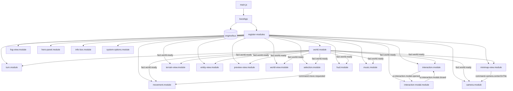
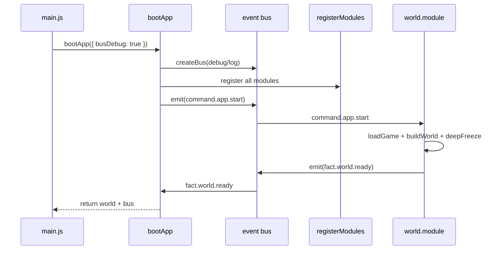
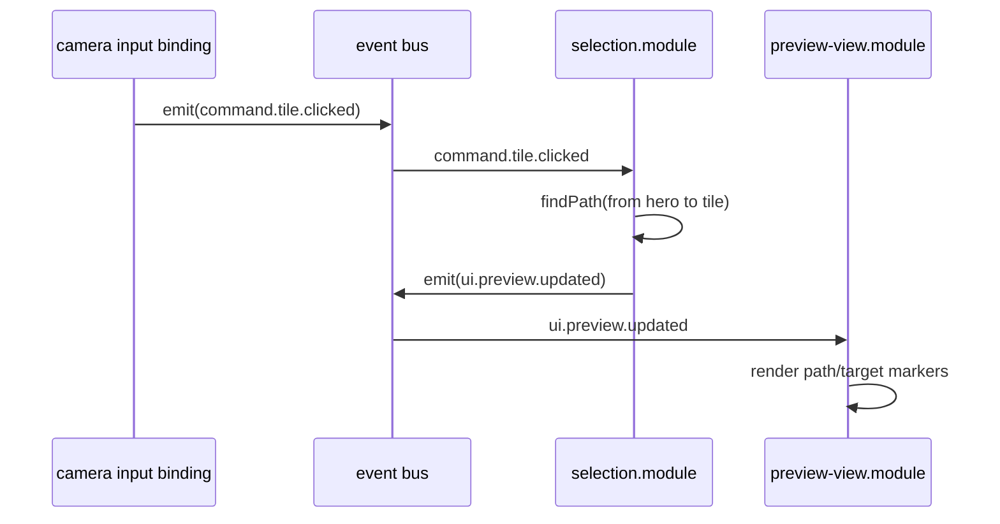
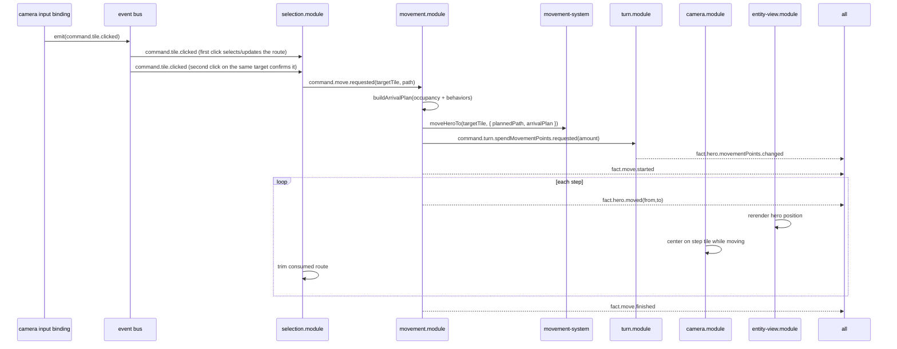

# Runtime Architecture (Bus-First Modules)

This document explains how the current runtime works on `main`.

It focuses on implementation structure and event flow. For gameplay requirements and acceptance behavior, see `docs/v1/SPEC.md`.

## 1) Architecture goals

The runtime is intentionally built around a few strict constraints:

- `bootApp` is minimal composition only; no feature logic.
- cross-module communication happens through the event bus, not direct imports/calls.
- each module owns its DOM querying, event subscriptions, internal state, and side effects.
- modules can use `engine/*` and `game/*`, but do not call each other directly.
- the `engine/` boundary remains strict: engine code never imports from `game/`.

This keeps feature behavior isolated, testable, and easier to extend without rewriting the bootstrap layer.

## 2) Runtime file map

Current runtime entry points:

```text
main.js
app/
  boot-app.js
  events.js
  modules/                   core modules, used by any game
    register-modules.js      core list + config.content.modules
    world.module.js
    movement.module.js
    interaction.module.js
    selection.module.js
    camera.module.js
    terrain-view.module.js
    entity-view.module.js
    fog-view.module.js
    preview-view.module.js
    world-view.module.js
    interaction-modal.module.js
    dev/bus-dev-panel.js
  heroes/                    Heroes content, picked in boot-app.js as config.content
    content.js               heroesAppContent
    interaction-outcomes.js  outcome kind -> facts and modal
    modules/                 turn, battle, town, mines, hud, ... (see the table in section 6)
    presentation/            entity styles, fade-outs, resource sprites
  ui/
    interaction-modal.element.js
game/
  heroes/                    Heroes rules: entity behaviors, footprints, turn system
```

Core code (`app/` outside `app/heroes/`, `game/` outside `game/heroes/`, `engine/`) never imports Heroes content; `tests/architecture/boundaries.test.js` enforces it. `app/boot-app.js` is the one place that picks the content.

`config.content` shape:

- `entityBehaviors`: list of `{ kind, arrivalInteraction?, footprintOffsets? }` (game rules per entity kind; `footprintOffsets` may be a function of the entity when its size depends on its type)
- `outcomeEffects`: map from outcome kind to `{ facts?, modal?, factsOnModalClosed? }`
- `outcomeEvents`: every event type the outcome effects can emit; the interaction module declares them in its `produces`
- `entityPresentation`: `{ getEntityStyle({ entity, map }), getFadeOutSpec({ entityKind }) }`
- `modules`: extra modules the game registers next to the core ones

## 3) Top-level architecture



## 4) Core contracts

### 4.1 Event bus contract (`engine/bus.js`)

The bus exposes:

- `addEventListener(type, handler)`
- `removeEventListener(type, handler)`
- `removeAllEventListeners(type?)`
- `getListenerCount(type?)`
- `emit(type, detail, options?)`
  - `options.log` defaults to `true` and controls event-log persistence
- `emitAll([{ type, detail }], options?)`: one commit. Every event of it is recorded and passed to `beforeDispatch` before any listener hears the first.
- `silent` mode flag (`bus.silent = true`) that suppresses listener dispatch while still allowing logging and `beforeDispatch`

Options of `createBus`:

- `beforeDispatch(event)`: called for each event after recording it and before its listeners. Boot passes the game state store's `apply`, so a listener already reads the new state.

Every emit is heard at once, also one made by a listener, so whoever emits a fact reads the state it left right after.

### 4.1a Game state store (`engine/store.js`, `app/game-state.js`)

The current game state, worked out by applying every saved fact in order; see `docs/notes/2026-10-25-game-state-store.md`. It is rebuilt on every load and never saved.

- Built from slices: the core ones in `game/state/core-slices.js` (players; heroes with their owner, tile and movement points; removed map objects; the date) and the content's own (`content.stateSlices` in `game/heroes/state/`: hero details, towns, mines, monster counts, kingdoms, fog).
- Fog of war: `game/state/fog.js` keeps each player's explored tiles (`createFogSlice`) and the core queries `isTileExplored` and `tilesExploredSince` read them; the content says who sees how far (`game/heroes/state/fog.js`). A scenario with `fogOfWar: false` has every tile explored. Unexplored tiles are blocked for routes, and views cover them.
- A slice is `{ key, initial(world), on: { [factType]: (slice, detail, { previousState, scenario, definitions, config }) => slice } }`. Only saved fact types may change it (`tests/architecture/game-state.test.js`). `fact.world.ready` starts it afresh.
- Income, creature growth and the day's building limit follow from `fact.turn.ended` inside the slices, so nothing is emitted unsaved to replay them.
- Modules read it through `state.get()` and the queries next to the slices (`heroById`, `townIdsOf`, `resourcesOf`, `viewingPlayer`, ...), never write it. Core modules use only the core queries in `game/state/queries.js`.

Debug mode (`createBus({ debug: true, log })`) reports structured entries for:

- subscribe / unsubscribe / remove-all actions
- emit actions with subscriber counts

### 4.2 Event taxonomy (`app/events.js`)

All events live in `app/events.js`. Facts saved to the event log are listed there too (`shouldPersistFactEvent`).

Event names follow prefixes:

- `command.*` = intent/request (`command.move.requested`, `command.turn.end.requested`)
- `fact.*` = domain truth/state transition (`fact.hero.moved`, `fact.turn.ended`)
- `ui.*` = presentation state updates (`ui.preview.updated`, `ui.music.state.changed`)

### 4.3 Module registration contract

Every runtime module follows this shape:

- primary API: `registerXModule({ bus, env, config, state })`
- setup receives `emit`, `emitAll`, `on` and the read-only `state` handle
- module registers all its own bus listeners
- module queries its own DOM dependencies via `env.document`

`registerModules` wires modules exactly once from `bootApp`.

## 5) Boot lifecycle

`bootApp` in `app/boot-app.js` is now composition + startup orchestration only.

High-level steps:

1. build optional bus dev panel when `busDebug` is enabled.
2. initialize `EventLog` (IndexedDB-backed with in-memory fallback).
3. create the game state store and the bus (`createBus`), with the store applying each fact before its listeners.
4. compose `env` (`fetch`, `document`, `window`, `AudioCtor`, `eventLog`).
5. compose `config` (defaults + overrides).
6. register all modules through `registerModules`.
7. wire reset command handling (`command.session.reset.requested` -> `eventLog.reset()` + `location.reload()`).
8. emit `command.app.start`.
9. await either:
   - `fact.world.ready` -> resolve boot and return `{ scenario, definitions, map, staticOccupancy, bus, eventLog }` (the world part is the frozen world-ready snapshot)
   - `fact.world.load.failed` -> reject boot
10. replay the saved facts, then emit `command.game.setup.requested`, which rolls what a game rolls once at its start (each Tree of Knowledge's price and each Witch Hut's skill). A reload emits it too; what the saved facts already rolled is kept.



## 6) Module responsibilities

What each module listens to and emits, generated from its declared `consumes`/`produces` by `node scripts/module-contracts.mjs`. The runtime throws when a module emits or listens to an event it did not declare, and `tests/architecture/module-contracts.test.js` fails when this table is out of date.

<!-- module-contracts:start -->
| Module | Source | Phase | Consumes | Produces |
|---|---|---|---|---|
| `world` | core | domain | `command.app.start` | `fact.world.ready`, `fact.world.load.failed` |
| `movement` | core | domain | `fact.world.ready`, `fact.entity.removed`, `command.route.requested`, `command.move.requested` | `command.turn.spendMovementPoints.requested`, `fact.route.planned`, `fact.move.started`, `fact.hero.moved`, `fact.move.finished` |
| `interaction` | core | domain | `fact.world.ready`, `ui.restore.started`, `ui.restore.completed`, `fact.move.finished`, `fact.interactions.queued`, `fact.monster.defeated`, `ui.interaction.modal.opened`, `ui.notice.opened`, `ui.interaction.modal.closed` | `ui.interaction.modal.opened`, `fact.entity.removed`, `fact.interactions.queued`, `fact.interaction.reached`, `command.dwelling.recruit.requested`, `ui.dwelling.recruit.openRequested`, `fact.battle.started`, `fact.resource.collected`, `fact.town.visited`, `fact.treasureChest.opened`, `command.hero.experience.gain.requested`, `command.resourceGenerator.visit.requested`, `command.bonusObject.visit.requested`, `ui.heroExchange.openRequested` |
| `selection` | core | domain | `fact.world.ready`, `fact.hero.movementPoints.changed`, `command.tile.clicked`, `command.hero.select.requested`, `command.move.continue.requested`, `fact.route.planned`, `fact.move.started`, `fact.hero.moved`, `fact.move.finished`, `ui.interaction.modal.opened`, `ui.interaction.modal.closed`, `ui.systemOptions.opened`, `ui.systemOptions.closed`, `ui.adventureMap.covered`, `ui.adventureMap.uncovered`, `ui.town.selected`, `ui.hero.selected`, `fact.hero.selected`, `fact.preview.target.selected`, `fact.preview.cleared` | `fact.hero.selected`, `command.move.requested`, `command.route.requested`, `ui.preview.updated`, `ui.selectedHero.clicked`, `fact.preview.target.selected`, `fact.preview.cleared` |
| `camera` | core | domain | `fact.world.ready`, `ui.restore.started`, `ui.restore.completed`, `ui.systemOptions.opened`, `ui.systemOptions.closed`, `ui.adventureMap.covered`, `ui.adventureMap.uncovered`, `command.camera.panBy`, `command.camera.centerOnTile`, `fact.move.started`, `fact.hero.moved`, `fact.move.finished` | `command.camera.panBy`, `command.tile.clicked`, `ui.camera.updated`, `ui.map.edgeScrolled`, `ui.tile.hovered`, `ui.tile.info.requested`, `ui.tile.info.dismissed`, `ui.world.motion.updated` |
| `terrain-view` | core | view | `fact.world.ready` | none |
| `entity-view` | core | view | `fact.world.ready`, `fact.hero.moved`, `fact.hero.hired`, `fact.entity.removed`, `ui.restore.started`, `ui.restore.completed` | none |
| `fog-view` | core | view | `fact.world.ready`, `fact.hero.moved`, `fact.town.captured`, `ui.dev.fogOfWar.changed` | none |
| `preview-view` | core | view | `fact.world.ready`, `ui.preview.updated` | none |
| `world-view` | core | view | `ui.restore.started`, `ui.restore.completed`, `ui.world.motion.updated`, `ui.camera.updated` | none |
| `interaction-modal` | core | view | `ui.interaction.modal.opened`, `ui.notice.opened` | `ui.interaction.modal.confirmed`, `ui.interaction.modal.closed` |
| `keyboard-shortcuts` | core | view | none | none |
| `turn` | heroes | domain | `fact.world.ready`, `fact.move.started`, `fact.move.finished`, `command.turn.spendMovementPoints.requested`, `command.turn.end.requested` | `fact.hero.movementPoints.changed`, `fact.turn.ended`, `ui.notice.opened` |
| `mines` | heroes | domain | `fact.interaction.reached` | `fact.mine.captured` |
| `dwellings` | heroes | domain | `fact.world.ready`, `fact.interaction.reached`, `ui.dwelling.recruit.openRequested`, `command.dwelling.recruit.requested` | `fact.dwelling.flagged`, `fact.resources.spent`, `fact.dwelling.creatures.recruited`, `fact.hero.army.changed`, `ui.dwelling.recruit.updated`, `ui.notice.opened` |
| `resource-generators` | heroes | domain | `fact.world.ready`, `command.resourceGenerator.visit.requested` | `fact.resourceGenerator.visited`, `ui.notice.opened` |
| `bonus-objects` | heroes | domain | `fact.world.ready`, `command.game.setup.requested`, `command.bonusObject.visit.requested`, `ui.interaction.modal.confirmed` | `fact.hero.bonusObject.visited`, `fact.bonusObject.prices.rolled`, `fact.resources.spent`, `ui.notice.opened`, `command.hero.experience.gain.requested` |
| `witch-huts` | heroes | domain | `fact.world.ready`, `command.game.setup.requested`, `command.bonusObject.visit.requested` | `fact.witchHut.skills.rolled`, `fact.witchHut.visited`, `fact.hero.secondarySkill.learned`, `ui.notice.opened` |
| `stat-boosting-objects` | heroes | domain | `fact.world.ready`, `command.bonusObject.visit.requested` | `fact.hero.battleBonus.gained`, `fact.hero.movementPoints.changed`, `ui.notice.opened` |
| `hero-levels` | heroes | domain | `fact.world.ready`, `command.hero.experience.gain.requested`, `ui.interaction.modal.confirmed`, `ui.restore.completed` | `fact.hero.experience.gained`, `fact.hero.leveledUp`, `fact.hero.secondarySkill.learned`, `ui.notice.opened` |
| `hero-army` | heroes | domain | `command.hero.stackMove.requested`, `command.hero.stackSplit.requested`, `command.heroes.stackMove.requested`, `command.heroes.stackSplit.requested`, `command.heroes.stackSend.requested`, `command.heroes.armySend.requested`, `command.heroes.armiesSwap.requested` | `fact.hero.army.changed` |
| `battle` | heroes | domain | `fact.world.ready`, `ui.restore.started`, `ui.restore.completed`, `fact.battle.started`, `fact.battle.stack.moved`, `fact.battle.stack.attacked`, `fact.battle.stack.shot`, `fact.battle.turn.ended`, `fact.battle.stack.waited`, `fact.battle.stack.defended`, `fact.battle.stack.froze`, `fact.battle.autoCombat.changed`, `fact.battle.finished`, `fact.battle.ended`, `command.battle.stackMove.requested`, `command.battle.stackAttack.requested`, `command.battle.stackShoot.requested`, `command.battle.stackWait.requested`, `command.battle.stackDefend.requested`, `command.battle.autoCombat.requested`, `command.battle.retreat.requested`, `command.battle.resultsClose.requested` | `ui.battle.updated`, `fact.battle.stack.moved`, `fact.battle.stack.attacked`, `fact.battle.stack.shot`, `fact.battle.turn.ended`, `fact.battle.stack.waited`, `fact.battle.stack.defended`, `fact.battle.stack.froze`, `fact.battle.autoCombat.changed`, `fact.battle.finished`, `fact.battle.ended`, `fact.monster.defeated`, `fact.monster.count.changed`, `fact.dwelling.guards.changed`, `fact.dwelling.flagged`, `fact.hero.army.changed`, `fact.entity.removed`, `command.hero.experience.gain.requested`, `ui.dwelling.recruit.openRequested` |
| `town` | heroes | domain | `fact.world.ready`, `fact.hero.army.changed`, `fact.hero.hired`, `fact.move.started`, `fact.move.finished`, `fact.interaction.reached`, `fact.town.captured`, `ui.adventureMap.covered`, `ui.adventureMap.uncovered`, `ui.interaction.modal.opened`, `ui.interaction.modal.closed`, `ui.systemOptions.opened`, `ui.systemOptions.closed`, `ui.town.selected`, `ui.hero.selected`, `command.tile.clicked`, `command.town.open.requested`, `fact.town.visited`, `fact.town.opened`, `command.town.leave.requested`, `fact.town.left`, `command.town.build.requested`, `command.town.recruit.requested`, `command.town.stackMove.requested`, `command.town.garrisonStackMove.requested`, `command.town.stackSplit.requested`, `fact.town.building.built`, `fact.town.garrison.changed` | `ui.town.updated`, `fact.hero.army.changed`, `fact.resources.spent`, `fact.town.building.built`, `fact.town.creatures.recruited`, `fact.town.garrison.changed`, `ui.town.message.opened`, `fact.town.opened`, `fact.town.left`, `fact.town.captured` |
| `tavern` | heroes | domain | `fact.world.ready`, `command.tavern.open.requested`, `command.tavern.hire.requested`, `fact.tavern.heroesOffered`, `fact.resources.spent`, `fact.hero.hired`, `fact.town.left` | `fact.tavern.heroesOffered`, `fact.resources.spent`, `fact.hero.hired`, `fact.hero.selected`, `ui.tavern.updated` |
| `owner-flag-view` | heroes | view | `fact.world.ready`, `fact.mine.captured`, `fact.dwelling.flagged`, `fact.town.captured` | none |
| `minimap-view` | heroes | view | `fact.world.ready`, `fact.hero.moved`, `fact.hero.hired`, `fact.entity.removed`, `fact.dwelling.flagged`, `fact.mine.captured`, `fact.town.captured`, `ui.camera.updated`, `ui.dev.fogOfWar.changed` | `command.camera.centerOnTile` |
| `hud` | heroes | view | `ui.preview.updated`, `fact.world.ready`, `fact.turn.ended`, `fact.resource.collected`, `fact.resourceGenerator.visited`, `fact.treasureChest.opened`, `fact.resources.spent` | `command.move.continue.requested`, `command.turn.end.requested` |
| `status-bar` | heroes | view | `fact.world.ready`, `ui.tile.hovered` | none |
| `adventure-cursor` | heroes | view | `fact.world.ready`, `fact.hero.moved`, `fact.entity.removed`, `fact.hero.movementPoints.changed`, `ui.tile.hovered`, `ui.map.edgeScrolled`, `fact.town.captured`, `ui.town.selected`, `ui.hero.selected` | none |
| `info-popup` | heroes | view | `fact.world.ready`, `ui.tile.info.requested`, `ui.tile.info.dismissed` | none |
| `hero-panel` | heroes | view | `fact.world.ready`, `fact.entity.removed`, `fact.hero.hired`, `fact.hero.selected`, `fact.hero.movementPoints.changed`, `ui.town.selected`, `fact.turn.ended`, `fact.town.left` | `command.camera.centerOnTile`, `command.hero.select.requested`, `ui.hero.selected`, `ui.heroScreen.openRequested` |
| `info-box` | heroes | view | `fact.world.ready`, `fact.hero.leveledUp`, `fact.hero.secondarySkill.learned`, `fact.hero.bonusObject.visited`, `fact.hero.battleBonus.gained`, `fact.hero.army.changed`, `ui.hero.selected`, `ui.town.selected`, `fact.town.garrison.changed`, `fact.town.building.built`, `fact.turn.ended`, `fact.resource.collected`, `fact.mine.captured`, `fact.move.started`, `ui.notice.opened`, `ui.interaction.modal.opened`, `ui.interaction.modal.closed`, `ui.restore.started`, `ui.restore.completed` | `command.hero.stackMove.requested`, `command.town.garrisonStackMove.requested` |
| `town-list` | heroes | view | `fact.world.ready`, `fact.town.captured`, `ui.hero.selected` | `ui.town.selected`, `command.camera.centerOnTile`, `command.town.open.requested` |
| `system-options` | heroes | view | `ui.music.state.changed` | `command.music.toggle.requested`, `command.session.reset.requested`, `ui.systemOptions.opened`, `ui.systemOptions.closed` |
| `battle-view` | heroes | view | `fact.world.ready`, `ui.restore.started`, `ui.restore.completed`, `ui.battle.updated`, `fact.battle.ended` | `command.battle.autoCombat.requested`, `command.battle.resultsClose.requested`, `command.battle.retreat.requested`, `command.battle.stackAttack.requested`, `command.battle.stackDefend.requested`, `command.battle.stackMove.requested`, `command.battle.stackShoot.requested`, `command.battle.stackWait.requested`, `ui.adventureMap.covered`, `ui.adventureMap.uncovered` |
| `town-screen-view` | heroes | view | `ui.town.updated`, `fact.town.left` | `command.town.leave.requested`, `command.town.open.requested`, `command.town.stackMove.requested`, `command.town.stackSplit.requested`, `ui.adventureMap.covered`, `ui.adventureMap.uncovered`, `ui.heroScreen.openRequested` |
| `town-hall-view` | heroes | view | `ui.town.updated`, `fact.town.building.built`, `fact.town.left` | `command.town.build.requested` |
| `town-fort-view` | heroes | view | `ui.town.updated`, `fact.town.left` | none |
| `town-recruit-view` | heroes | view | `ui.town.updated`, `fact.town.creatures.recruited`, `ui.town.message.opened`, `fact.town.left` | `command.town.recruit.requested` |
| `dwelling-recruit-view` | heroes | view | `ui.dwelling.recruit.updated`, `fact.dwelling.creatures.recruited` | `command.dwelling.recruit.requested`, `ui.adventureMap.covered`, `ui.adventureMap.uncovered` |
| `tavern-view` | heroes | view | `ui.town.updated`, `ui.tavern.updated`, `fact.hero.hired`, `fact.town.left` | `command.tavern.open.requested`, `command.tavern.hire.requested` |
| `hero-screen-view` | heroes | view | `fact.world.ready`, `fact.hero.army.changed`, `ui.adventureMap.covered`, `ui.adventureMap.uncovered`, `ui.selectedHero.clicked`, `ui.heroScreen.openRequested` | `command.hero.stackMove.requested`, `command.hero.stackSplit.requested`, `ui.adventureMap.covered`, `ui.adventureMap.uncovered` |
| `hero-exchange-view` | heroes | view | `fact.world.ready`, `fact.hero.army.changed`, `ui.heroExchange.openRequested` | `command.heroes.stackMove.requested`, `command.heroes.stackSplit.requested`, `command.heroes.stackSend.requested`, `command.heroes.armySend.requested`, `command.heroes.armiesSwap.requested`, `ui.adventureMap.covered`, `ui.adventureMap.uncovered` |
| `music` | heroes | view | `fact.world.ready`, `command.music.toggle.requested` | `ui.music.state.changed` |
<!-- module-contracts:end -->

### 6.1 Domain-first vs view modules

Runtime modules are intentionally split into two categories:

- domain/control modules and view/projection modules; each module's `phase` is in the table above.

`register-modules.js` registers the core modules plus the game's `config.content.modules`, domain modules first, then view modules, which keeps event flow intuitive and avoids a bootstrap god-object.

Route selection vs. movement:

- `selection.module` owns the selected target and route, the select-then-confirm click flow, and when a confirm is allowed (hero idle, no modal open, movement points left). It knows nothing about the map: on a click it emits `command.route.requested { tile }`, and turns the answer into the persisted `fact.preview.target.selected { tile, path }` (or clears the preview when `path` is null). Storing the path in the fact means a reload restores the exact route without planning again. Confirming emits `command.move.requested`.
- `movement.module` owns the hero and everything about routes: it answers `command.route.requested` with `fact.route.planned { tile, path }` (path or null) and executes `command.move.requested`. Any other input (keyboard, minimap, AI) can emit those commands directly without going through selection.
- `interaction.module` needs no map either: `fact.move.finished` names the entity the hero arrived at (`interaction.entityId`), and the module resolves the outcome from that entity's behavior.

World state:

- `world.module` only loads the scenario and emits a deeply frozen `fact.world.ready` snapshot: `scenario`, `definitions`, `map` and `staticOccupancy`. It holds no live state.
- `staticOccupancy` (`game/build-world.js`) indexes everything that never moves (entities plus the footprint blockers from each behavior's `footprintOffsets`). Heroes are left out on purpose, so a hero standing on a town never hides it. It only exposes `getAt(tile)`.
- the hero's tile comes from the facts themselves: `fact.hero.moved` carries `to`, `fact.move.started` carries `from`, `fact.move.finished` carries `heroId` and `reachedTile`.
  - only `movement` remembers it, as one `heroTile` variable set from the snapshot and then from each `to`.
  - `camera` centers on the tile in each fact, `selection` trims its route by `to` and compares `reachedTile`, `entity-view` moves the hero element to `to`; none of them keep a copy.
- `removedIds` (`game/domain/removed-entities.js`): ids taken off the map, updated from the generic `fact.entity.removed`. Kept by `movement` and `adventure-cursor` (route planning, through `game/systems/hero-routes.js`) and `entity-view` (full re-render).
- `getOccupantAt` (`game/domain/tile-occupant.js`) answers "what stands on this tile": the static entry, unless it was removed. Only `movement` uses it.
- an entity behavior marks an outcome with `removesEntity: true`; `app/modules/shared/interaction-outcomes.js` then emits `fact.entity.removed` with the outcome's own facts. Nothing outside the behavior needs to know which kinds disappear.
- the movement system takes queries, not entity lists: `createMovementSystem({ getHero, occupancy })`, and exposes `planRoute(tile)` and `moveHeroTo(tile)`. `createHeroRoutes` (`game/systems/hero-routes.js`) keeps those queries up to date from facts and builds the system; `adventure-cursor` builds its own to plan a route for every hovered tile without a bus round trip.

### 6.2 Reusable UI components (custom elements)

For complex, reusable UI surfaces (like interaction dialogs), the runtime uses custom elements under `app/ui/`.

Current example:

- `app/ui/interaction-modal.element.js` defines `<interaction-modal>` and owns:
  - internal template structure (title/message/actions)
  - open/close transitions
  - modal-local keyboard/click handling

Why this pattern is used:

- keeps bus modules orchestration-focused (event in -> event out), not template-heavy
- centralizes modal behavior in one place for future interactions (resources/towns/multi-action dialogs)
- makes UI behavior testable directly with component-level tests (`app/ui/*.test.js`)

How to use going forward:

1. create/extend component API (`open(payload)`, `close()`, custom close event).
2. keep the module as controller (listen to bus, mount component, translate component events back to bus).
3. avoid direct domain logic in the component; domain stays in `game/systems/*` + domain modules.
4. keep selectors owned by component internals; callers should not depend on component internals unless tests require it.

## 7) Important end-to-end flows

### 7.1 Tile click -> route selection (first click)



### 7.2 Confirmed movement (second click same tile)



### 7.3 End turn during movement

- `hud.module` emits `command.turn.end.requested` when button is clicked.
- `turn.module` ignores this command while `isMoving === true`.
- `isMoving` is derived only from bus facts:
  - set `true` on `fact.move.started`
  - set `false` on `fact.move.finished`

This ensures end-turn cannot race movement completion.

### 7.4 Partial movement and remainder preview

- `movement-system` caps executed steps to remaining movement points.
- each executed step emits `fact.hero.moved`.
- `selection.module` progressively trims the route on each move fact.
- after `fact.move.finished`:
  - if target is not reached, remaining route stays previewed (red over-limit segment support via `maxAffordableSteps`)
  - if target is reached, preview clears

This is the canonical behavior for long routes in the current runtime.

### 7.5 Music toggle

- on `fact.world.ready`, `music.module` lazily initializes player and emits initial `ui.music.state.changed`.
- on `command.music.toggle.requested`, module toggles player and emits updated UI state.
- `system-options.module` is the single owner of the music button label and `aria-pressed` rendering; the button lives in the System options popup.

### 7.6 Monster combat -> modal -> deferred removal

- `movement.module` computes an `arrivalPlan` before executing movement (using destination occupant behavior).
- `movement-system` executes the provided plan (stop-before vs step-into), spends movement cost, and reports `fact.move.finished` with `interaction.kind`.
- `interaction.module` resolves combat from move-finished context and emits `ui.interaction.modal.opened`.
- `interaction-modal.module` mounts `<interaction-modal>` in `.viewport`.
- closing the modal emits `ui.interaction.modal.closed`.
- on close, `interaction.module` emits `fact.monster.defeated` immediately (the defeat is committed only once the player acknowledges the modal; a reload while the modal is open keeps the monster).
- the same close also emits `fact.entity.removed`; modules add the id to their `removedIds`, so the tile is free again.
- `entity-view.module` fades the monster element out on `fact.entity.removed` and removes it after the presentation's `durationMs` (overridable per kind with `config.fadeOutMsByKind`; immediately during restore).

### 7.7 Resource collection

- `interaction.module` emits `fact.resource.collected` as soon as the arrival resolves (no modal).
- it also emits `fact.entity.removed`, so modules drop the resource from their tile lookups and it can't be targeted again.
- `hud.module` updates totals immediately; `entity-view.module` fades the element out on its own.
- domain facts never wait on view animations, so a reload mid-fade keeps the resource collected.

## 8) DOM ownership map

Each module owns the selectors it queries and updates:

- `camera.module`: `.viewport`, `.world` (camera movement and click-to-tile input binding)
- `terrain-view.module`: `.terrain-layer` (terrain render)
- `entity-view.module`: `.entity-layer` (entity render)
- `preview-view.module`: `.effects-layer` (path preview svg render)
- `interaction-modal.module`: `.viewport` (mount/unmount custom modal element)
- `hud.module`:
  - `.ui-layer` (stop propagation)
  - `#resource-bar-list` (resource bar items and amounts)
  - `#calendar-status` (date at the end of the resource bar)
  - `#move-hero-button` (move-continue command source)
  - `#end-turn-button` (end-turn command source)
- `hero-panel.module`:
  - `#hero-list` (hero portrait + movement bar; portrait click centres the camera)
  - `#next-hero-button` (centres the camera; disabled with no movement left)
- `info-box.module`:
  - `#hero-info` (the selected hero or town, a pickup or a captured mine, the date at the start of a day; a click goes on to the kingdom overview, then the date)
- `system-options.module`:
  - `#system-options-button` (opens the popup)
  - the System options `<dialog>` it mounts in `.game-shell` (Music, Reset, Return to game)
- `boot-app.js`: no feature DOM ownership; only optional bus dev panel composition

`<interaction-modal>` owns its internal dialog DOM and interaction handlers; other modules interact with it through its public API and close event.

## 9) Debug observability

With `bootApp({ busDebug: true })`:

- `engine/bus` emits debug entries containing action/type/detail/subscriber count.
- `app/modules/dev/bus-dev-panel.js` renders a collapsible event stream.
- panel behavior:
  - hidden by default
  - toggle button shows event count
  - per-entry kind badge (`command`, `fact`, `ui`, `other`)
  - subscriber count (`subs: N`) for each emitted event

Panel styles are in `app/modules/dev/bus-dev-panel.css`.

## 10) Testing strategy and seams

### 10.1 Behavior tests (main safety net)

End-to-end behavior scenarios live in `tests/behavior/*` and boot the real module graph.

Behavior tests run on Vitest fake timers (`tests/behavior/fake-timers.setup.js`), so movement steps, battle steps and fade-outs advance only when a test calls `waitMs(ms)`. `config.movementStepDelayMs` and `config.battleStepDelayMs` set how long each step takes.

### 10.2 Unit tests (only where behavior tests can't reach)

Unit tests are kept only where they catch something behavior tests can't:

- `engine/pathfinding.test.js`: routing rules (no corner cutting, tie-breaking, shortest detours)
- `engine/eventlog.test.js`: real IndexedDB saving and the in-memory fallback (behavior tests use an in-memory log)
- `game/load.test.js`, `game/heroes/demo-scenario.test.js`: scenario validation and checks on the real demo map data
- `game/audio/*.test.js`: track selection and missing or broken music manifests
- `app/ui/interaction-modal.element.test.js`: native dialog quirks (Escape, backdrop, unexpected close)
- `app/session-db-name.test.js`: PR previews keep separate saves
- `tests/architecture/boundaries.test.js`: layering rules

Module wiring (module X reacts to event A by emitting B) is not unit tested; behavior tests cover it.

## 11) Extension playbook (how to add a feature safely)

1. define new events using the `command.*` / `fact.*` / `ui.*` naming scheme in `app/events.js`.
2. implement feature logic in a single module (or a small set of modules) under `app/modules/`.
3. keep communication bus-first; do not call another module directly.
4. if DOM is involved, decide between:
   - module-owned direct DOM (simple projections), or
   - custom element under `app/ui/` (reusable/interactive UI).
5. if using a custom element, keep module as bus/controller layer and component as UI implementation.
6. register a core module in `app/modules/register-modules.js`, or a game-specific one in that game's content (`modules` in `app/heroes/content.js`).
7. add behavior tests first; add a unit test only for what behavior tests can't reach (see 10.2).

## 12) Invariants to keep

When editing architecture, preserve these invariants:

- `bootApp` stays composition/startup only.
- no `deps` god-object passed from boot into feature logic.
- no module-to-module direct calls for runtime behavior.
- bus events are the only cross-module coordination channel.
- persisted state changes only in `fact.*` handlers. Command handlers decide (e.g. `decideEndTurn` in `game/heroes/turn-system.js`) and emit facts; they never assign state themselves. Live play and replay therefore run the same code.
- `fact.world.ready` is a deeply frozen snapshot (`scenario`, `definitions`, `map`, `staticOccupancy`); nobody mutates shared world objects. Changes during play live only in small state derived from facts (`heroTile`, `removedIds`), kept only where a module needs it later (see "World state").
- `engine/` never imports from `game/`.
- core `game/` code never imports `game/heroes/`; the game's content (entity behaviors) is chosen in `bootApp` as `config.content` and passed to modules (see `ENTITY_ARCHETYPES.md`).
- behavior tests validate user-observable flows; unit tests exist only for what behavior tests can't reach (see 10.2).
